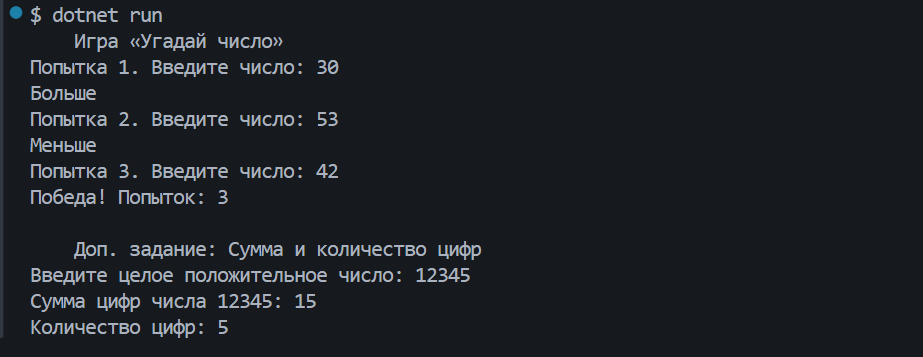
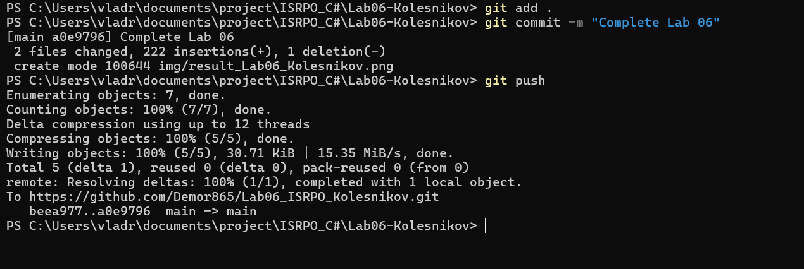

# Практическая работа №6

**ФИО:** Колесников Владислав Александрович  
**Группа:** ИСП-241

## Что изучено

- Цикл `for` используется, когда количество повторений известно заранее, а `while` — когда нужно повторять действия до выполнения какого-то условия.
- Цикл `do while` гарантирует, что тело цикла выполнится хотя бы один раз, так как условие проверяется после выполнения тела.
- Оператор `break` позволяет досрочно выйти из цикла (например, когда мы угадали число), а `continue` — пропустить текущую итерацию и перейти к следующей.

## Скриншоты

1. 
2. 
